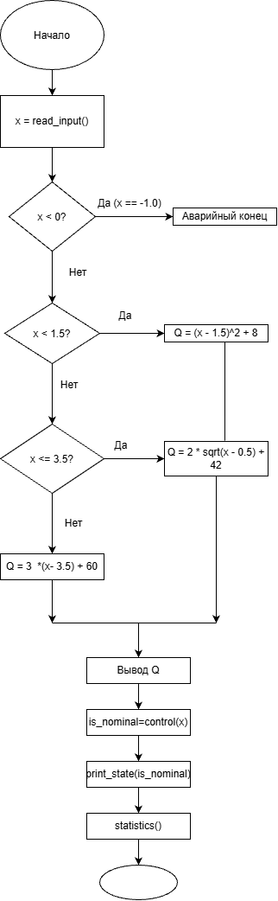

# Курсовой проект

## Вариант 10. Мониторинг реактора: давление на выходе

### Постановка задачи

Необходимо разработать программу для преобразования показаний датчика давления на выходе реактора \(X\) в величину технологического процесса \(Q\).

**Диапазон давления:**

\(0.5 \le X \le 5\) бар.

### Преобразование показания

$$
Q(X) = \begin{cases} 
\frac{(X - 1.5)^2}{1} + 8, & X < 1.5 \\ 
2\sqrt{X - 2.5 + 2} + 42, & 1.5 \le X \le 3.5 \\ 
3(X - 3.5) + 60, & X > 3.5 
\end{cases}
$$

### Программа должна

1. Получить значение давления \(X\).
2. Проверить принадлежность к диапазону штатного режима: \(1.5 \le X \le 3.5\) бар.
3. Рассчитать величину \(Q(X)\) согласно условиям ветвления.
4. Вывести результат \(Q(X)\).

### Контрольные примеры для ручного тестирования

Проверка работы алгоритма на каждой ветви кусочной функции:
1. **Ветка 1 ($X < 1.5$):** При $X = 1.0$, расчет: $Q = (1.0 - 1.5)^2 + 8 = 0.25 + 8 = \mathbf{8.25}$
2. **Ветка 2 ($1.5 \le X \le 3.5$):** При $X = 3.30$, расчет: $Q = 2 \cdot \sqrt{3.30 - 2.5 + 2} + 42 = 2 \cdot \sqrt{2.8} + 42 \approx \mathbf{45.35}$ (Штатный режим)
3. **Ветка 3 ($X > 3.5$):** При $X = 4.0$, расчет: $Q = 3 \cdot (4.0 - 3.5) + 60 = 1.5 + 60 = \mathbf{61.50}$

### Поведение системы при выходе за границы технологического диапазона [0.5; 5.0]
Если датчик давления передает значения $X < 0.5$ или $X > 5.0$ бар, данные признаются недостоверными (критический сбой оборудования). Программа блокирует вычисление $Q$, выводит предупреждение об аварийной ситуации в консоль и завершает выполнение с кодом ошибки.

### Блок-схема

### Программа

Исходный код программы находится в файле `main.c`.
